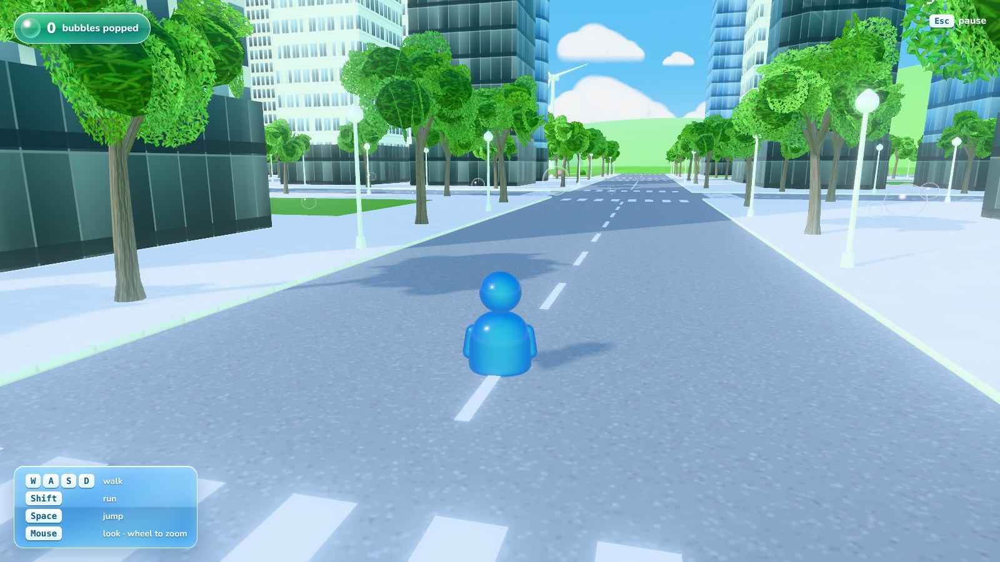
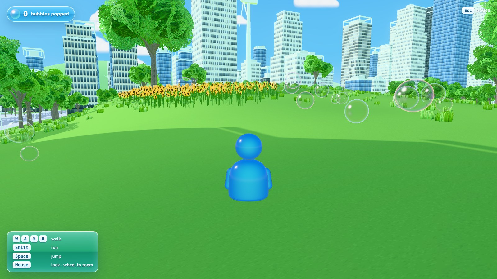
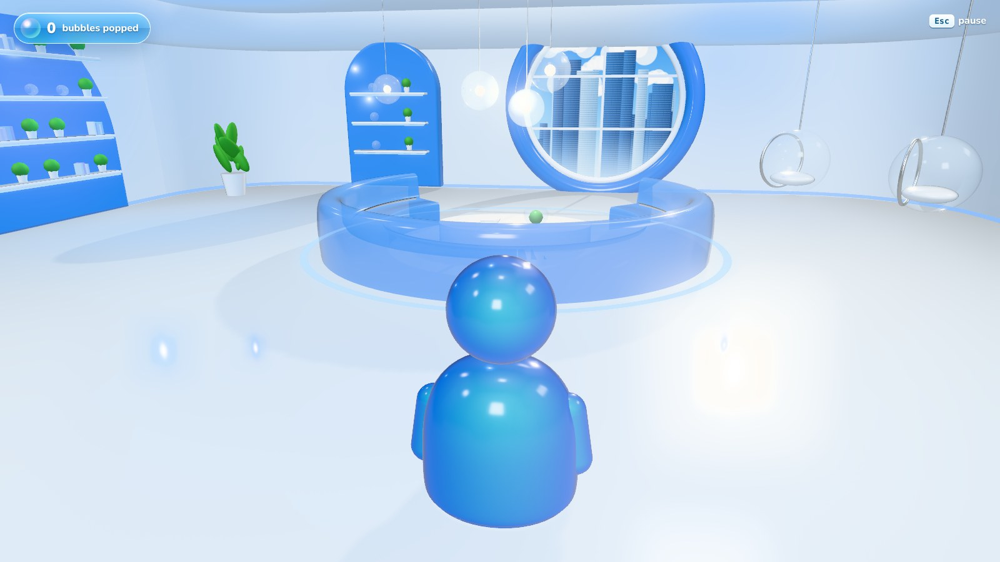
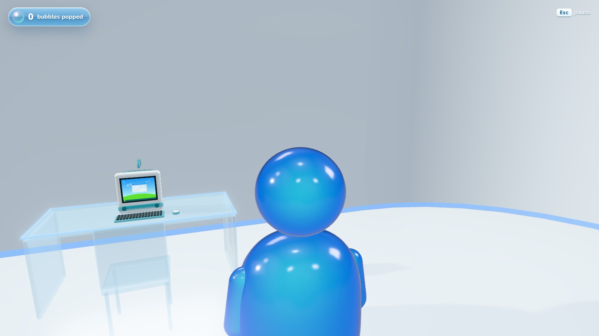
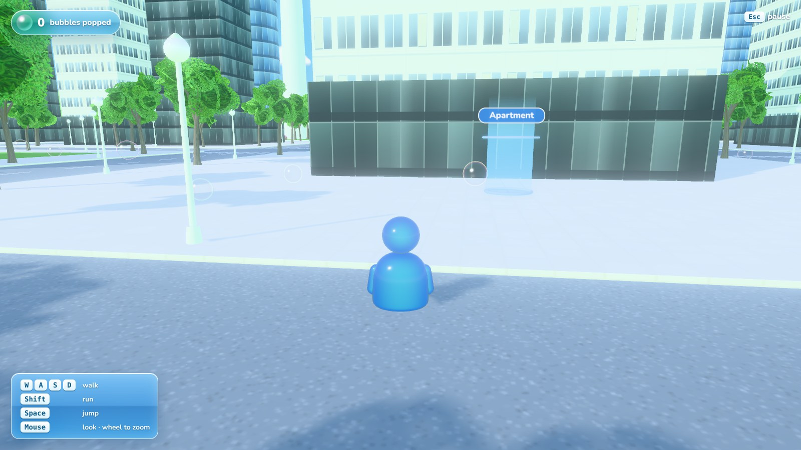

# Frutiger Fun

A Frutiger Aero free-roam city: glossy glass towers, a lake park full of
bright green trees, a wooden boardwalk, pink azaleas, soap bubbles and a
big white sun. This is the **menu screen demo**. The menu is fully
working, and **Play** drops you into the city to wander around.

## Play it

launch the website https.etc.com

It needs a browser with WebGL 2. Graphics can be set to **Low** in Options
for slower computers.

## Controls

| Key | Action |
| --- | --- |
| `W` `A` `S` `D` or arrow keys | walk |
| `Shift` | run |
| `Space` | jump |
| Mouse (click the game to capture it), or hold the right button | look around |
| Mouse wheel | zoom the camera |
| `Esc` | pause |
| `↑` `↓` and `Enter` | choose items in the menus |

Touch a bubble to pop it. The counter is at the top left.

## What's in it

- **Main menu:** a glossy logo, aero glass buttons, a clock and weather
  gadget, a swoosh, and Aero waving at you from the boardwalk. The 3D
  scene keeps moving behind the menu, and the music starts once you click
  or press a key.
- **Options:** High or Low graphics, music and effect volume, mouse
  sensitivity, invert look, FPS counter. Settings are saved in the browser.
- **Credits** and **Quit** windows, and a pause menu while you play.
- **The city:** about 100 city blocks around a central lake park. It has
  realistic high-rises (white and grey concrete towers with window grids,
  blue and dark glass towers, lobbies, setbacks and rooftop crowns), a TV
  tower, tree-lined streets with lamps and crosswalks, and small pocket
  parks with fountains.
- **The countryside:** wind turbines on the hills and around the city, and
  sunflower patches and fields.
- **The apartment:** walk north out of the park to the white tower with the
  glowing blue circle and the "Apartment" sign, and step into the circle.
  Inside is a white-and-blue living room: a round window onto the skyline,
  a curved translucent blue sofa round an oval table, glowing shelves,
  hanging bubble chairs, glass pendant lights, and a clear desk with a
  Bondi Blue all-in-one computer. The blue circle by the door takes you
  back outside.
- **Cursors:** pixel-art arrow and pointing-hand cursors in the menus.
- **Grass:** real grass blades that sway in the wind cover the lawns and
  fields around you.
- **The park:** rolling hills, walks lined with hedges and rope fences, a
  promenade around the lake, reeds, rocks, benches, and a fountain in the
  lake.
- **The look:** the lake mirrors the city, there is a lens flare when you
  look at the sun, plus soft bloom, drifting clouds, trees that sway in
  the wind, and rainbow-rimmed soap bubbles.

| | |
| --- | --- |
|  |  |
|  |  |
|  | |

| File | What it does |
| --- | --- |
| `src/main.js` | renderer, lights, post-processing, game states, main loop |
| `src/layout.js` | the map: park, lake, paths, boardwalk, ground heights |
| `src/city.js` | blocks, towers, roads, street trees and lamps |
| `src/park.js` | trees, hedges, fences, flowers and reeds in the park; the menu shot |
| `src/terrain.js` | the painted park ground, roads, distant hills |
| `src/nature.js` | instanced trees, bushes, grass tufts, sunflowers and rocks |
| `src/grass.js` | the field of swaying grass blades around the player |
| `src/props.js` | lamps, benches, fences and the boardwalk |
| `src/sky.js` | sky, clouds, lens flare |
| `src/water.js` | lake reflection and fountain |
| `src/bubbles.js` | soap bubbles |
| `src/character.js` | Aero, its animation, optional glTF model |
| `src/player.js` | movement, collisions, third-person camera |
| `src/ui.js`, `src/style.css` | menus, windows and HUD |
| `src/windmills.js` | wind turbines |
| `src/apartment.js` | the apartment interior, its furniture and the blue entrance circles |
| `src/cursors.css` | the pixel-art cursors |
| `src/audio.js` | music (`assets/music.mp3`) and sound effects |

## Credits

- [three.js](https://threejs.org/), MIT License
  ([licenses/three.js-LICENSE.txt](licenses/three.js-LICENSE.txt))
- [Nunito](https://github.com/googlefonts/nunito) typeface, SIL Open Font
  License 1.1 ([licenses/Nunito-OFL.txt](licenses/Nunito-OFL.txt))
- Character design reference:
  [Frutiger Aero Character V2](https://sketchfab.com/3d-models/frutiger-aero-character-v2-b58344c11a064f36bbc6992067e7f9e0)
  on Sketchfab

Every texture, tree, building and sound is generated when the game starts.
