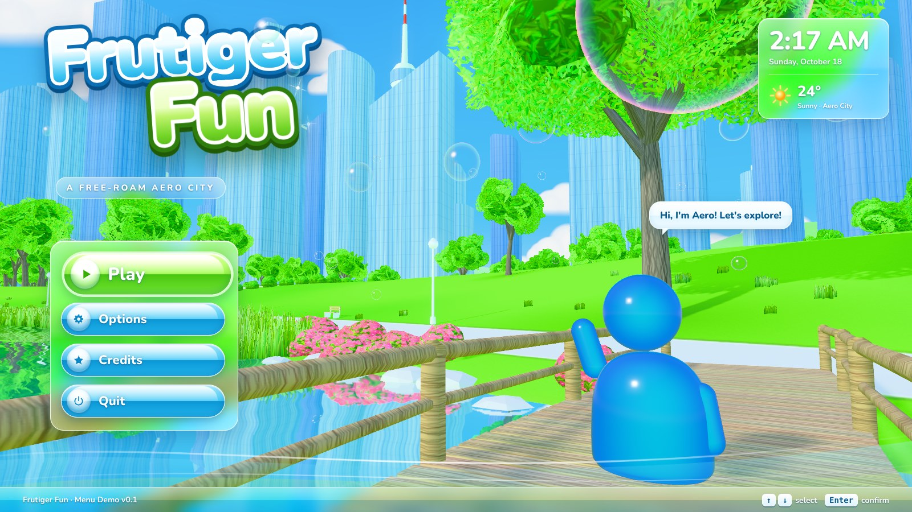
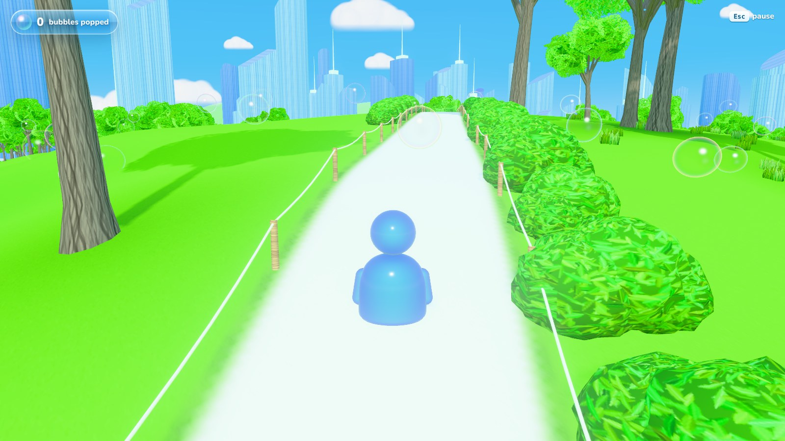
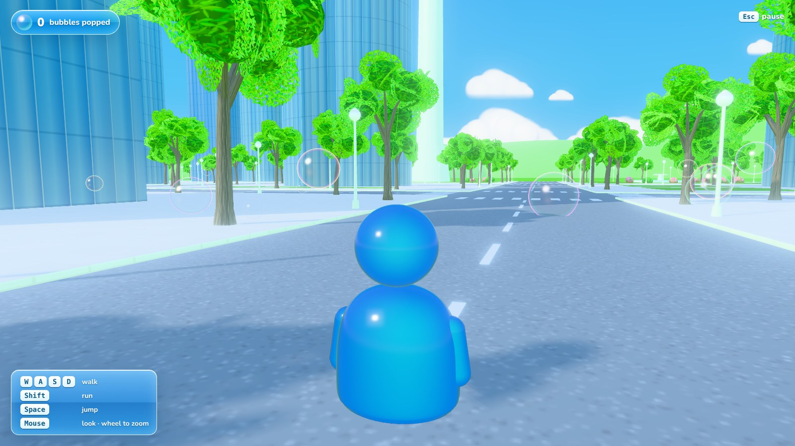

# Frutiger Fun

A Frutiger Aero free-roam city: glossy glass towers, a lake park full of
bright green trees, a wooden boardwalk, pink azaleas, soap bubbles and a
big white sun. This is the **menu screen demo**. The menu is fully
working, and **Play** drops you into the city to wander around.



## Play it

- **From disk:** download the repository and open `index.html` in Chrome,
  Edge or Firefox. You don't need a server or an install.
- **Online:** turn on GitHub Pages for this repository (Settings → Pages →
  deploy from the `main` branch, root folder). The game is then at
  `https://lenodrips-create.github.io/frutigerfun-game/`.

It needs a browser with WebGL 2. Graphics can be set to **Low** in Options
for slower computers.

## Controls

| Key | Action |
| --- | --- |
| `W` `A` `S` `D` or arrow keys | walk |
| `Shift` | run |
| `Space` | jump |
| Mouse (click the game to capture it), or hold the right button | look around |
| Mouse wheel | zoom the camera |
| `Esc` | pause |
| `↑` `↓` and `Enter` | choose items in the menus |

Touch a bubble to pop it. The counter is at the top left.

## What's in it

- **Main menu:** a glossy logo, aero glass buttons, a clock and weather
  gadget, a swoosh, and Aero waving at you from the boardwalk. The 3D
  scene keeps moving behind the menu, and you get synthesised music once
  you click or press a key.
- **Options:** High or Low graphics, music and effect volume, mouse
  sensitivity, invert look, FPS counter. Settings are saved in the browser.
- **Credits** and **Quit** windows, and a pause menu while you play.
- **The city:** about 100 city blocks around a central lake park. It has
  slim silver and blue glass skyscrapers with sliced, angled tops and
  spires, a TV tower, tree-lined streets with lamps and crosswalks, and small pocket
  parks with fountains.
- **The park:** rolling hills, walks lined with hedges and rope fences, a
  promenade around the lake, reeds, rocks, benches, and a fountain in the
  lake.
- **The look:** the lake mirrors the city, there is a lens flare when you
  look at the sun, plus soft bloom, drifting clouds, trees that sway in
  the wind, and rainbow-rimmed soap bubbles.

| | |
| --- | --- |
|  |  |

## The character

The player character, **Aero**, is a glossy blue buddy in the style of the
classic messenger icon: a round head on a bell-shaped body with little
arms, bright cyan in the middle and dark blue at the edges. It waddles and
hops when it walks and waves from the boardwalk on the menu.

To use the real model, download it from Sketchfab as **glTF Binary
(.glb)** and save it as `assets/character.glb`. The game loads it
automatically, scales it to player height and, if the model has idle,
walk or run animations, plays them. The model only loads when the game is
served over http(s), for example on GitHub Pages or with `npm run serve`.
Browsers block it when you open the page straight from disk.

## Working on it

The source is in `src/`. `dist/` holds the built bundle that `index.html` loads, and it is
committed so the game runs without a build step.

```sh
npm install
npm run build    # rebuild dist/ once
npm run serve    # rebuild on change and serve on http://localhost:8080
```

| File | What it does |
| --- | --- |
| `src/main.js` | renderer, lights, post-processing, game states, main loop |
| `src/layout.js` | the map: park, lake, paths, boardwalk, ground heights |
| `src/city.js` | blocks, towers, roads, street trees and lamps |
| `src/park.js` | trees, hedges, fences, flowers and reeds in the park; the menu shot |
| `src/terrain.js` | the painted park ground, roads, distant hills |
| `src/nature.js` | instanced trees, bushes, grass and rocks |
| `src/props.js` | lamps, benches, fences and the boardwalk |
| `src/sky.js` | sky, clouds, lens flare |
| `src/water.js` | lake reflection and fountain |
| `src/bubbles.js` | soap bubbles |
| `src/character.js` | Aero, its animation, optional glTF model |
| `src/player.js` | movement, collisions, third-person camera |
| `src/ui.js`, `src/style.css` | menus, windows and HUD |
| `src/audio.js` | music and sound effects (Web Audio) |

## Credits

- [three.js](https://threejs.org/), MIT License
  ([licenses/three.js-LICENSE.txt](licenses/three.js-LICENSE.txt))
- [Nunito](https://github.com/googlefonts/nunito) typeface, SIL Open Font
  License 1.1 ([licenses/Nunito-OFL.txt](licenses/Nunito-OFL.txt))
- Character design reference:
  [Frutiger Aero Character V2](https://sketchfab.com/3d-models/frutiger-aero-character-v2-b58344c11a064f36bbc6992067e7f9e0)
  on Sketchfab

Every texture, tree, building and sound is generated when the game starts.
